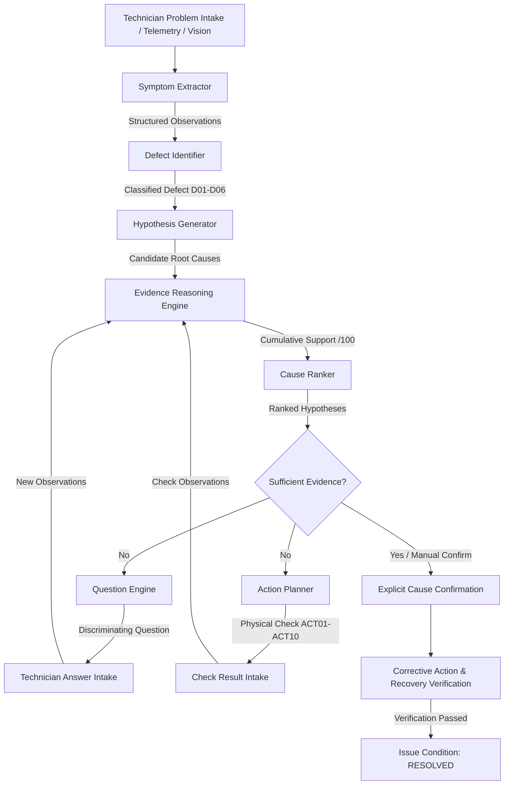

# DispenseLens - Diagnostic Engine & Workflow Summary

> **Engineer:** KoayPH (Member 2 - AI & Diagnostic Intelligence)  
> **System:** DispenseLens Industrial Dispensing Defect Diagnosis Platform  
> **Focus:** Deterministic Reasoning, Epistemic State Separation, Bounded AI, & Evidence-Based Troubleshooting  

---

## 1. Executive Summary & Interview Pitch

> **Interview Elevator Pitch:**  
> *"In DispenseLens, I architected and implemented the core AI & Diagnostic Intelligence Layer. Rather than building a generic generative chatbot or opaque black-box neural classifier, I engineered an offline-capable, deterministic diagnostic reasoning engine grounded in industrial epistemic hygiene and mathematical explainability.  
> The system evaluates cumulative evidence support scores out of 100 across multi-way relations (supports, contradicts, neutral, duplicate), dynamically selects high-gain troubleshooting actions, enforces strict 4-dimensional state independence between physical check execution and root-cause confirmation, and employs a bounded LLM architecture exclusively for natural language explanations with zero-overhead deterministic fallback."*

---

## 2. Detailed Technical Breakdown by Module

### Section 1: Core Diagnostic Orchestrator & Multi-Dimensional State Management

* **Full Diagnostic Lifecycle Orchestration:**
  * Implemented [`DiagnosticEngine`](file:///c:/Users/koay/Documents/KOAY%20KOAY%20FILES/USM/AI%20Horizon/dispense_lense_koi/backend/app/services/diagnosis/engine.py#L646-L838), the central orchestrator coordinating problem intake, natural-language symptom extraction, defect identification, hypothesis generation, evidence scoring, cause ranking, and next-step selection.
  * Formatted the diagnostic session as an iterative human-in-the-loop cycle: technician answers, physical check results, and calibrated CV optics feed back into the engine to continuously adjust hypothesis weights.
* **Strict 4-Dimensional State Management:**
  * Implemented [`StateManager`](file:///c:/Users/koay/Documents/KOAY%20KOAY%20FILES/USM/AI%20Horizon/dispense_lense_koi/backend/app/services/diagnosis/engine.py#L71-L244) to enforce strict decoupling across four independent operational dimensions:
    1. **Step Execution:** `PENDING`, `IN_PROGRESS`, `COMPLETED`, `BLOCKED`, `SKIPPED`, `FAILED`, `UNKNOWN`, `NOT_APPLICABLE`
    2. **Step Finding:** `SUPPORTS`, `CONTRADICTS`, `INCONCLUSIVE`, `UNKNOWN`, `NOT_APPLICABLE`
    3. **Cause Conclusion:** `SUSPECTED`, `CONFIRMED`, `UNRESOLVED`
    4. **Issue Condition:** `UNRESOLVED`, `RECOVERY_PENDING_VERIFICATION`, `RESOLVED`, `RECURRED`
  * **Interview Talking Point (Epistemic Hygiene):** Prevents invalid automated assumptions:
    * Completing a check $\neq$ Check supports a cause.
    * A check supporting a cause $\neq$ Root cause confirmed.
    * Confirming a root cause $\neq$ Dispensing issue resolved. Issue resolution strictly requires independent post-repair verification test shots.
* **Immutable Analysis Revisions & Delta Audit Trails:**
  * Built an immutable revision history model (`AnalysisRevision`, Revision $N \to N+1$) via [`_detect_revision_changes`](file:///c:/Users/koay/Documents/KOAY%20KOAY%20FILES/USM/AI%20Horizon/dispense_lense_koi/backend/app/services/diagnosis/engine.py#L1011-L1050) tracking every score delta, hypothesis rank flip, and new evidence summary for auditability.
* **Explicit Root Cause Confirmation Protocol:**
  * Designed [`confirm_cause()`](file:///c:/Users/koay/Documents/KOAY%20KOAY%20FILES/USM/AI%20Horizon/dispense_lense_koi/backend/app/services/diagnosis/engine.py#L883-L950) requiring explicit technician/engineer authorization before any candidate cause transitions from `SUSPECTED` to `CONFIRMED`.
* **Example Files:**
  * Master Orchestrator: [`backend/app/services/diagnosis/engine.py`](file:///c:/Users/koay/Documents/KOAY%20KOAY%20FILES/USM/AI%20Horizon/dispense_lense_koi/backend/app/services/diagnosis/engine.py)
  * Unit Test Suite: [`backend/tests/unit/test_diagnosis_engine.py`](file:///c:/Users/koay/Documents/KOAY%20KOAY%20FILES/USM/AI%20Horizon/dispense_lense_koi/backend/tests/unit/test_diagnosis_engine.py)
  * Lifecycle Integration Suite: [`backend/tests/test_phases_9_11.py`](file:///c:/Users/koay/Documents/KOAY%20KOAY%20FILES/USM/AI%20Horizon/dispense_lense_koi/backend/tests/test_phases_9_11.py)

---

### Section 2: Deterministic Evidence Reasoning Engine & Scoring Model

* **Mathematical Traceability vs. Generative Scoring:**
  * Built [`EvidenceEngine`](file:///c:/Users/koay/Documents/KOAY%20KOAY%20FILES/USM/AI%20Horizon/dispense_lense_koi/backend/app/services/diagnosis/evidence_engine.py#L143-L324) to evaluate all incoming observations against candidate root causes deterministically.
  * Explicitly labels scores as `Evidence Support: XX/100` rather than false probability distributions; causes do not artificially sum to 100%.
* **Multi-Way Evidence Relations:**
  * Categorizes every (observation, cause) pair into one of four relations:
    * `SUPPORTS`: Adds positive score contribution (Strong: +20, Moderate: +12, Weak: +5).
    * `CONTRADICTS`: Subtracts score penalty (Strong: -18, Moderate: -10, Weak: -4).
    * `NEUTRAL`: 0 score change.
    * `DUPLICATE`: 0 score contribution.
* **Semantic Duplicate & Correlation Suppression:**
  * Implemented [`_is_duplicate()`](file:///c:/Users/koay/Documents/KOAY%20KOAY%20FILES/USM/AI%20Horizon/dispense_lense_koi/backend/app/services/diagnosis/evidence_engine.py#L108-L137) and semantic clustering ([`_SEMANTIC_GROUPS`](file:///c:/Users/koay/Documents/KOAY%20KOAY%20FILES/USM/AI%20Horizon/dispense_lense_koi/backend/app/services/diagnosis/evidence_engine.py#L47-L59)).
  * **Interview Talking Point:** Prevents artificial score inflation. If an operator notes *"dots are too small"* and a calibrated camera detects *"undersized deposit"*, the engine recognizes the semantic overlap, ignores the duplicate, and prevents double-counting.
* **Missing Evidence vs. Explicit Contradiction:**
  * Distinguishes between unverified observations and contradictory findings; applies a bounded missing evidence penalty (capped at 15 pts) to prevent premature overconfidence during initial intake.
* **Centralized Scoring Configuration:**
  * Centralized all weights, penalties, and thresholds into [`ScoringConfig`](file:///c:/Users/koay/Documents/KOAY%20KOAY%20FILES/USM/AI%20Horizon/dispense_lense_koi/backend/app/utils/scoring.py#L17-L66) for auditable parameter tuning without altering reasoning algorithms.
* **Example Files:**
  * Evidence Engine: [`backend/app/services/diagnosis/evidence_engine.py`](file:///c:/Users/koay/Documents/KOAY%20KOAY%20FILES/USM/AI%20Horizon/dispense_lense_koi/backend/app/services/diagnosis/evidence_engine.py)
  * Scoring Configuration: [`backend/app/utils/scoring.py`](file:///c:/Users/koay/Documents/KOAY%20KOAY%20FILES/USM/AI%20Horizon/dispense_lense_koi/backend/app/utils/scoring.py)
  * Unit Tests: [`backend/tests/unit/test_evidence_engine.py`](file:///c:/Users/koay/Documents/KOAY%20KOAY%20FILES/USM/AI%20Horizon/dispense_lense_koi/backend/tests/unit/test_evidence_engine.py) and [`backend/tests/unit/test_scoring.py`](file:///c:/Users/koay/Documents/KOAY%20KOAY%20FILES/USM/AI%20Horizon/dispense_lense_koi/backend/tests/unit/test_scoring.py)

---

### Section 3: Hypothesis Generation & Cause Ranking Engine

* **Candidate Cause Ranking:**
  * Implemented [`CauseRanker`](file:///c:/Users/koay/Documents/KOAY%20KOAY%20FILES/USM/AI%20Horizon/dispense_lense_koi/backend/app/services/diagnosis/cause_ranker.py#L108-L241) to sort candidate causes by net evidence score and identify `high_confidence_causes` ($\ge 75/100$).
* **Inspectable Breakdown Data Structures:**
  * Created [`RankingResult.get_cause_explanation()`](file:///c:/Users/koay/Documents/KOAY%20KOAY%20FILES/USM/AI%20Horizon/dispense_lense_koi/backend/app/services/diagnosis/cause_ranker.py#L60-L93), exposing full arithmetic transparency: base score, positive evidence contributions, contradiction penalties, missing evidence deductions, and final clamped score.
* **Example Files:**
  * Cause Ranker: [`backend/app/services/diagnosis/cause_ranker.py`](file:///c:/Users/koay/Documents/KOAY%20KOAY%20FILES/USM/AI%20Horizon/dispense_lense_koi/backend/app/services/diagnosis/cause_ranker.py)
  * Unit Tests: [`backend/tests/unit/test_cause_ranker.py`](file:///c:/Users/koay/Documents/KOAY%20KOAY%20FILES/USM/AI%20Horizon/dispense_lense_koi/backend/tests/unit/test_cause_ranker.py)

---

### Section 4: Natural Language Symptom Extraction & Traceable Defect Classification

* **High-Precision Symptom Parsing:**
  * Built [`SymptomExtractor`](file:///c:/Users/koay/Documents/KOAY%20KOAY%20FILES/USM/AI%20Horizon/dispense_lense_koi/backend/app/services/diagnosis/symptom_extractor.py#L140-L295) using structured regex keyword tables mapping text to normalized observation types (deposit size, shape, air bubbles, spreading, temporal drift, spatial nozzle patterns, material viscosity).
  * **Interview Talking Point (Epistemic Hygiene):** Explicitly separates statements into `USER_OBSERVATION`, `USER_INTERPRETATION`, or `AI_INFERENCE`. If an operator inputs *"I suspect the nozzle is clogged"*, it is recorded as a user hypothesis and never converted into an established physical fact.
* **Deterministic Defect Classification:**
  * Built [`identify_defect()`](file:///c:/Users/koay/Documents/KOAY%20KOAY%20FILES/USM/AI%20Horizon/dispense_lense_koi/backend/app/services/diagnosis/defect_identifier.py#L80-L215), mapping observations into the 6 mandatory industrial dispensing defects:
    * `D01_TOO_LITTLE`: Insufficient deposit volume.
    * `D02_TOO_MUCH`: Excessive material volume.
    * `D03_INCONSISTENT_SIZE`: Shot-to-shot variation or progressive runtime drift.
    * `D04_MISSING_DOTS`: Absent deposits or skipped shots.
    * `D05_SPREADING`: Excessive substrate wetting, bleeding, or pancake dots.
    * `D06_BUBBLES_ABNORMAL_SHAPE`: Air voids, tailing, stringing, or satellite dots.
  * Yields an inspectable [`DefectMatch`](file:///c:/Users/koay/Documents/KOAY%20KOAY%20FILES/USM/AI%20Horizon/dispense_lense_koi/backend/app/services/diagnosis/defect_identifier.py#L25-L45) with confidence metrics and human-readable reasoning.
* **Example Files:**
  * Symptom Extractor: [`backend/app/services/diagnosis/symptom_extractor.py`](file:///c:/Users/koay/Documents/KOAY%20KOAY%20FILES/USM/AI%20Horizon/dispense_lense_koi/backend/app/services/diagnosis/symptom_extractor.py)
  * Defect Identifier: [`backend/app/services/diagnosis/defect_identifier.py`](file:///c:/Users/koay/Documents/KOAY%20KOAY%20FILES/USM/AI%20Horizon/dispense_lense_koi/backend/app/services/diagnosis/defect_identifier.py)
  * Unit Tests: [`backend/tests/unit/test_symptom_extractor.py`](file:///c:/Users/koay/Documents/KOAY%20KOAY%20FILES/USM/AI%20Horizon/dispense_lense_koi/backend/tests/unit/test_symptom_extractor.py) and [`backend/tests/unit/test_defect_classifier.py`](file:///c:/Users/koay/Documents/KOAY%20KOAY%20FILES/USM/AI%20Horizon/dispense_lense_koi/backend/tests/unit/test_defect_classifier.py)

---

### Section 5: Adaptive Question Discrimination Engine & Answer Normalization

* **Dynamic Hypothesis-Discriminating Question Engine:**
  * Implemented [`QuestionEngine`](file:///c:/Users/koay/Documents/KOAY%20KOAY%20FILES/USM/AI%20Horizon/dispense_lense_koi/backend/app/services/diagnosis/question_engine.py#L67-L260) to evaluate candidate questions (`Q01`–`Q15`) against current competing hypotheses based on information gain, cause coverage, and uncertainty reduction.
  * **Interview Talking Point:** Instead of displaying an exhaustive questionnaire, the engine selects the single question best suited to differentiate competing hypotheses, stopping questioning automatically when sufficient confidence is achieved.
* **Technician Answer Handling & Normalization:**
  * Built [`QuestionAnswerHandler`](file:///c:/Users/koay/Documents/KOAY%20KOAY%20FILES/USM/AI%20Horizon/dispense_lense_koi/backend/app/services/diagnosis/question_answer_handler.py#L425-L567) validating input against accepted answer values.
  * Edge-case safety: `UNKNOWN` answers produce 0 observations (preventing fabricated evidence), and `NOT_APPLICABLE` prevents false contradictions.
* **Example Files:**
  * Question Engine: [`backend/app/services/diagnosis/question_engine.py`](file:///c:/Users/koay/Documents/KOAY%20KOAY%20FILES/USM/AI%20Horizon/dispense_lense_koi/backend/app/services/diagnosis/question_engine.py)
  * Question Answer Handler: [`backend/app/services/diagnosis/question_answer_handler.py`](file:///c:/Users/koay/Documents/KOAY%20KOAY%20FILES/USM/AI%20Horizon/dispense_lense_koi/backend/app/services/diagnosis/question_answer_handler.py)
  * Unit Tests: [`backend/tests/unit/test_question_engine.py`](file:///c:/Users/koay/Documents/KOAY%20KOAY%20FILES/USM/AI%20Horizon/dispense_lense_koi/backend/tests/unit/test_question_engine.py) and [`backend/tests/unit/test_question_answer_handler.py`](file:///c:/Users/koay/Documents/KOAY%20KOAY%20FILES/USM/AI%20Horizon/dispense_lense_koi/backend/tests/unit/test_question_answer_handler.py)

---

### Section 6: Action Planner & Troubleshooting Check Handler

* **Physical Effort-Aware Action Planner:**
  * Implemented [`ActionPlanner`](file:///c:/Users/koay/Documents/KOAY%20KOAY%20FILES/USM/AI%20Horizon/dispense_lense_koi/backend/app/services/diagnosis/action_planner.py#L67-L249) to select the next physical troubleshooting check (`ACT01`–`ACT10`).
  * **Interview Talking Point (Decoupling Cause Order from Action Order):** The highest-ranked cause does not dictate the immediate next action. The planner balances information gain with physical technician effort (applying penalties for high-effort valve teardown vs. low-effort nozzle visual checks), prioritizing fast, non-invasive verifications first.
* **Troubleshooting Check Execution Handler:**
  * Implemented [`CheckResultHandler`](file:///c:/Users/koay/Documents/KOAY%20KOAY%20FILES/USM/AI%20Horizon/dispense_lense_koi/backend/app/services/diagnosis/engine.py#L388-L630) to handle check execution outcomes.
  * **Critical Shopfloor Safety Rule:** If an action is `BLOCKED` (e.g. nozzle inspection blocked because an inspection microscope is unavailable), the finding remains strictly `UNKNOWN`. Non-performed checks are never translated into negative findings ("No blockage found").
* **Example Files:**
  * Action Planner: [`backend/app/services/diagnosis/action_planner.py`](file:///c:/Users/koay/Documents/KOAY%20KOAY%20FILES/USM/AI%20Horizon/dispense_lense_koi/backend/app/services/diagnosis/action_planner.py)
  * Check Result Handler: [`backend/app/services/diagnosis/engine.py` (Lines 388–630)](file:///c:/Users/koay/Documents/KOAY%20KOAY%20FILES/USM/AI%20Horizon/dispense_lense_koi/backend/app/services/diagnosis/engine.py#L388-L630)
  * Unit Tests: [`backend/tests/unit/test_action_planner.py`](file:///c:/Users/koay/Documents/KOAY%20KOAY%20FILES/USM/AI%20Horizon/dispense_lense_koi/backend/tests/unit/test_action_planner.py) and [`backend/tests/unit/test_check_result_handler.py`](file:///c:/Users/koay/Documents/KOAY%20KOAY%20FILES/USM/AI%20Horizon/dispense_lense_koi/backend/tests/unit/test_check_result_handler.py)

---

### Section 7: Computer Vision Measurement Integration Bridge

* **Connecting Quantitative Optics to Diagnostic Decisions:**
  * Integrated physical OpenCV measurement results (deposit area deviation, circularity, void presence, spreading ratio) into structured diagnostic observations in [`measurement.py`](file:///c:/Users/koay/Documents/KOAY%20KOAY%20FILES/USM/AI%20Horizon/dispense_lense_koi/backend/app/services/vision/measurement.py) and [`engine.py`](file:///c:/Users/koay/Documents/KOAY%20KOAY%20FILES/USM/AI%20Horizon/dispense_lense_koi/backend/app/services/diagnosis/engine.py).
  * Calibrated camera inspection data feeds directly into the Evidence Engine, automatically triggering cause re-ranking and defect identification.
* **Example Files:**
  * Measurement Integration: [`backend/app/services/vision/measurement.py`](file:///c:/Users/koay/Documents/KOAY%20KOAY%20FILES/USM/AI%20Horizon/dispense_lense_koi/backend/app/services/vision/measurement.py)
  * Unit Verification: [`backend/tests/unit/test_opencv_image_decision_making.py`](file:///c:/Users/koay/Documents/KOAY%20KOAY%20FILES/USM/AI%20Horizon/dispense_lense_koi/backend/tests/unit/test_opencv_image_decision_making.py)

---

### Section 8: Bounded LLM Explanations & Industrial Safety Guardrails

* **"Bounded AI" Architectural Pattern:**
  * Designed and built [`ExplanationService`](file:///c:/Users/koay/Documents/KOAY%20KOAY%20FILES/USM/AI%20Horizon/dispense_lense_koi/backend/app/services/ai/explanation_service.py) and [`LLMService`](file:///c:/Users/koay/Documents/KOAY%20KOAY%20FILES/USM/AI%20Horizon/dispense_lense_koi/backend/app/services/ai/llm_service.py).
  * **Interview Talking Point (Safety & Determinism):** The LLM possesses zero diagnostic authority. It cannot compute scores, alter rankings, invent checks, or confirm causes. Its sole role is translating deterministic engine outputs into natural language engineering summaries.
* **Graceful Degradation & 100% Offline Capability:**
  * If the LLM provider fails, times out, or hallucinates an unsupported check ID, the engine automatically falls back to deterministic rule-based template generation without disrupting the diagnostic workflow.
* **Isolated Prompt Management:**
  * Decoupled system prompts into [`PromptManager`](file:///c:/Users/koay/Documents/KOAY%20KOAY%20FILES/USM/AI%20Horizon/dispense_lense_koi/backend/app/services/ai/prompt_manager.py) to separate prompt engineering from application logic.
* **Example Files:**
  * Explanation Service: [`backend/app/services/ai/explanation_service.py`](file:///c:/Users/koay/Documents/KOAY%20KOAY%20FILES/USM/AI%20Horizon/dispense_lense_koi/backend/app/services/ai/explanation_service.py)
  * LLM Service: [`backend/app/services/ai/llm_service.py`](file:///c:/Users/koay/Documents/KOAY%20KOAY%20FILES/USM/AI%20Horizon/dispense_lense_koi/backend/app/services/ai/llm_service.py)
  * Prompt Manager: [`backend/app/services/ai/prompt_manager.py`](file:///c:/Users/koay/Documents/KOAY%20KOAY%20FILES/USM/AI%20Horizon/dispense_lense_koi/backend/app/services/ai/prompt_manager.py)
  * Output Verification Tests: [`backend/tests/unit/test_ai_outputs.py`](file:///c:/Users/koay/Documents/KOAY%20KOAY%20FILES/USM/AI%20Horizon/dispense_lense_koi/backend/tests/unit/test_ai_outputs.py)

---

### Section 9: Knowledge Representation & Typed Data Contracts

* **Decoupled Semiconductor Knowledge Base:**
  * Created structured static JSON knowledge files defining validated cleanroom dispensing relationships:
    * 6 Defect Types: [`defects.json`](file:///c:/Users/koay/Documents/KOAY%20KOAY%20FILES/USM/AI%20Horizon/dispense_lense_koi/backend/app/knowledge/defects.json)
    * 18+ Root Causes: [`causes.json`](file:///c:/Users/koay/Documents/KOAY%20KOAY%20FILES/USM/AI%20Horizon/dispense_lense_koi/backend/app/knowledge/causes.json)
    * 100+ Evidence Rules: [`rules.json`](file:///c:/Users/koay/Documents/KOAY%20KOAY%20FILES/USM/AI%20Horizon/dispense_lense_koi/backend/app/knowledge/rules.json)
    * 15 Diagnostic Questions: [`questions.json`](file:///c:/Users/koay/Documents/KOAY%20KOAY%20FILES/USM/AI%20Horizon/dispense_lense_koi/backend/app/knowledge/questions.json)
    * 10 Physical Actions: [`actions.json`](file:///c:/Users/koay/Documents/KOAY%20KOAY%20FILES/USM/AI%20Horizon/dispense_lense_koi/backend/app/knowledge/actions.json)
    * Knowledge Base Loader: [`backend/app/knowledge/__init__.py`](file:///c:/Users/koay/Documents/KOAY%20KOAY%20FILES/USM/AI%20Horizon/dispense_lense_koi/backend/app/knowledge/__init__.py)
* **Strongly-Typed Pydantic Data Contracts:**
  * Authored typed domain contracts in [`diagnosis.py`](file:///c:/Users/koay/Documents/KOAY%20KOAY%20FILES/USM/AI%20Horizon/dispense_lense_koi/backend/app/schemas/diagnosis.py) ensuring consistency across frontend, database, and backend boundaries.
* **Example Files:**
  * Data Contracts: [`backend/app/schemas/diagnosis.py`](file:///c:/Users/koay/Documents/KOAY%20KOAY%20FILES/USM/AI%20Horizon/dispense_lense_koi/backend/app/schemas/diagnosis.py)
  * Knowledge Loader: [`backend/app/knowledge/__init__.py`](file:///c:/Users/koay/Documents/KOAY%20KOAY%20FILES/USM/AI%20Horizon/dispense_lense_koi/backend/app/knowledge/__init__.py)

---

### Section 10: Automated Benchmark Framework & Multi-Phase Test Suites

* **Automated Evaluation Benchmark:**
  * Built [`BenchmarkRunner`](file:///c:/Users/koay/Documents/KOAY%20KOAY%20FILES/USM/AI%20Horizon/dispense_lense_koi/backend/app/evaluation/benchmark.py#L43-L176) to validate engine performance across test scenarios.
  * Implemented 8 evaluation metrics in [`metrics.py`](file:///c:/Users/koay/Documents/KOAY%20KOAY%20FILES/USM/AI%20Horizon/dispense_lense_koi/backend/app/evaluation/metrics.py):
    1. Defect Classification Accuracy
    2. Top-1 Cause Accuracy
    3. Top-3 Cause Coverage
    4. Average Questions to Resolution
    5. Evidence Traceability Rate (100% of score deltas mapped to explicit rules)
    6. Contradiction Handling Pass Rate
    7. Duplicate Evidence Suppression Rate
    8. LLM Failure Resilience Rate
* **Multi-Phase Verification Suites:**
  * Built test suites covering phases 1–11: [`test_phases_1_5.py`](file:///c:/Users/koay/Documents/KOAY%20KOAY%20FILES/USM/AI%20Horizon/dispense_lense_koi/backend/tests/test_phases_1_5.py), [`test_phases_6_8.py`](file:///c:/Users/koay/Documents/KOAY%20KOAY%20FILES/USM/AI%20Horizon/dispense_lense_koi/backend/tests/test_phases_6_8.py), and [`test_phases_9_11.py`](file:///c:/Users/koay/Documents/KOAY%20KOAY%20FILES/USM/AI%20Horizon/dispense_lense_koi/backend/tests/test_phases_9_11.py).
* **Example Files:**
  * Benchmark Runner: [`backend/app/evaluation/benchmark.py`](file:///c:/Users/koay/Documents/KOAY%20KOAY%20FILES/USM/AI%20Horizon/dispense_lense_koi/backend/app/evaluation/benchmark.py)
  * Evaluation Metrics: [`backend/app/evaluation/metrics.py`](file:///c:/Users/koay/Documents/KOAY%20KOAY%20FILES/USM/AI%20Horizon/dispense_lense_koi/backend/app/evaluation/metrics.py)
  * Evaluation Test Suite: [`backend/tests/unit/test_evaluation_framework.py`](file:///c:/Users/koay/Documents/KOAY%20KOAY%20FILES/USM/AI%20Horizon/dispense_lense_koi/backend/tests/unit/test_evaluation_framework.py)

---

## 3. Interview Talking Points Cheat Sheet

| Question / Topic | How to Answer (Key Rationale) |
| :--- | :--- |
| **Why not just use an LLM with prompting for diagnosis?** | Manufacturing cleanrooms require deterministic, repeatable, and auditable reasoning. LLMs suffer from hallucination, non-deterministic scoring, and unexplainable outputs. In DispenseLens, the diagnostic engine is 100% deterministic and offline-capable; the LLM is bounded strictly to narrative summarization. |
| **How does your scoring work?** | It is an evidence accumulation model (`Evidence Support /100`) rather than probability. Each observation is matched against knowledge rules as SUPPORTS, CONTRADICTS, NEUTRAL, or DUPLICATE. Contradictions subtract score penalties, missing evidence incurs bounded deductions, and duplicate observations contribute 0 weight to prevent score inflation. |
| **How do you handle technician statements vs facts?** | Through strict epistemic hygiene in `SymptomExtractor`. If a user says *"I think the nozzle is blocked"*, it is tagged as `USER_INTERPRETATION` and stored as a user hypothesis. It is never auto-promoted to a confirmed physical observation or root cause. |
| **Why decouple action ranking from cause ranking?** | In real shopfloors, the most likely root cause might require a 2-hour valve disassembly, while a lower-ranked cause can be ruled out with a 10-second visual inspection. The `ActionPlanner` balances hypothesis coverage with physical technician effort to prioritize high-gain, low-effort checks first. |
| **How do you prevent premature case resolution?** | Through 4-dimensional state management in `StateManager`. A check being completed does not confirm a cause; confirming a cause does not resolve an issue. An issue can only transition to `RESOLVED` when explicit post-repair verification test shots are recorded. |
